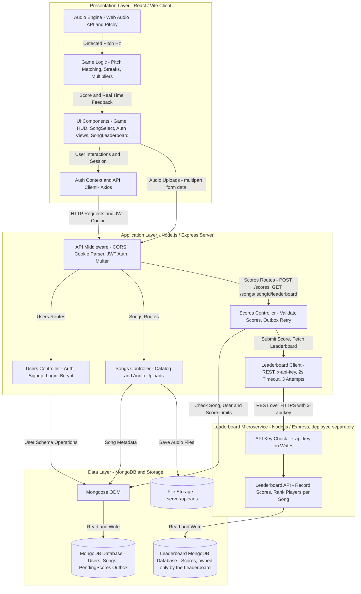

# Architecture

Models here are **diagrams-as-code**, kept in this repository and reviewed like
code, rather than as standalone UML documents. Mermaid renders directly on
GitHub, so a diagram in this file stays readable without any tooling. Flowchart
syntax, including `subgraph` for layers, is documented at
<https://mermaid.js.org/syntax/flowchart.html>.

## Layers

<How your system decomposes into layers, and what each layer is responsible
for. See Engineering Software Products Figures 4.10 and 4.11. Use one
`subgraph` per layer, named for the concern it owns. Replace the example
below.>

## Qualities

<The non-functional qualities you decided matter most, per Table 4.2 and
Figure 4.4, and what you traded away to get them.>

1. **Responsiveness (Low Latency)**
   - **Choice:** Real-time pitch detection runs entirely in the browser via the Web Audio API and `pitchy`.
   - **Trade-off:** Increases client-side CPU usage, but eliminates network latency and server bandwidth costs for real-time audio analysis.

2. **Usability (Zero-Install)**
   - **Choice:** Web-based SPA accessible instantly in modern browsers.
   - **Trade-off:** Constrained by browser audio permissions and sandboxing, but avoids requiring users to install native desktop software.

3. **Security (Safe Sessions)**
   - **Choice:** Passwords hashed with `bcrypt`; session JWTs stored in `httpOnly` cookies.
   - **Trade-off:** Requires explicit CORS credentials configuration, but protects authentication tokens from client-side XSS theft.

4. **Availability (Leaderboard Failure Isolation)**
   - **Choice:** The leaderboard runs as a separate microservice. The main server calls it with a 2-second timeout and up to 3 attempts, and a score that cannot be delivered is saved to a `PendingScore` outbox and re-sent once the service responds again.
   - **Trade-off:** Adds a second deployment, a second database and network calls that can fail, but a leaderboard outage never blocks login, song selection or gameplay, and no finished score is lost.

## Decisions

<Record the decisions worth remembering, and what you rejected. A design you
considered and dropped is often more informative than the one you kept, and
these notes are what a design defense draws on. Technology choices, per
Table 4.8, belong here too.>

| Decision | Alternatives considered | Why this one |
| --- | --- | --- |
| <decision> | <what else> | <reasoning> |

| **Database: MongoDB + Mongoose** | PostgreSQL / MySQL | Flexible document schema naturally fits nested song note arrays and user profiles during agile development. |

| **Platform:** Web App (React + Vite SPA) | Native iOS/Android, React Native | Zero-install accessibility in any desktop browser placed beside a piano keyboard, using standard Web Audio APIs. |

| **Server:** Public Cloud PaaS (e.g. Render / AWS + Atlas) | In-house physical servers, Serverless (AWS Lambda) | Zero hardware maintenance; containerized Node instance easily handles audio file uploads and persistent routing. |

| **Open-Source:** MIT/Apache 2.0 (`pitchy`, `bcrypt`, `multer`) | Commercial audio SDKs, GPL libraries (Aubio) | Open-source licenses avoid licensing fees and copyleft constraints while providing fast, lightweight pitch detection. |

| **Leaderboard as a microservice** (`leaderboard/`) with its own database | Scores routes and a `Score` collection inside the main Express server | Scores have a narrow boundary (a song id, a player and the result) and a different load from logins and uploads. Running separately, the leaderboard can be deployed and scaled on its own, and its failures stay out of the rest of the app. |

| **Main server calls the leaderboard; the browser never does** | Client calls the leaderboard service directly | The main server already knows the logged-in player from the JWT cookie and owns the song data needed to reject impossible scores, so only it holds the leaderboard's API key. The browser keeps talking to a single API. |

| **Outbox (`PendingScore`) for scores the leaderboard misses** | Return an error and drop the score; let the client retry | Scores are stored in the main database when the leaderboard is down and re-sent after the next successful call. Each score carries a `scoreId`, and the service ignores a `scoreId` it already has, so re-sending is safe. |

| **Dev Tools:** Vite + Express | Next.js (SSR), Rails | Decoupled client/server architecture avoids SSR conflicts with browser-only Web Audio APIs and allows independent scaling. |