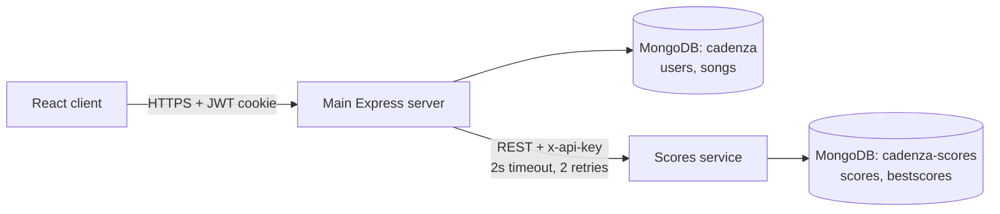

# Microservice

The microservice this group added, either as a new feature or in place of part
of the existing application. Diagrams here are Mermaid, like those in
[architecture.md](architecture.md). When the service changes the architecture,
update the *Layers* diagram there too, and record the choices under
*Decisions*.

## Design

**What it does.** The **scores service** (`scores-service/`) is Cadenza's
leaderboard. It records every finished game and ranks each player's best run
per song. It is a new feature: before it, a score disappeared when the results
screen closed, even though the product vision promises leaderboards.

**Why it is a good candidate.** Of everything in Cadenza, scores have the
cleanest boundary and the most different load:

- It needs only two facts from the rest of the system, a song id and who the
  player is, and nothing about how songs are stored, uploaded or played.
- Every finished game writes a score, and leaderboards are read whenever a song
  is selected, so its traffic grows with play time while logins and uploads
  stay rare. It can be scaled, cached or rewritten on its own.
- If it fails, Cadenza loses only the leaderboard. Songs, login and the game
  keep working.

**How it is built.** It is a small Node.js/Express app with its own
`package.json`, deployed separately from the main server.

| Part | File | Role |
| --- | --- | --- |
| HTTP API | `app.js`, `routes/scores.js` | Validates input and serves the endpoints below |
| API-key check | `middleware/requireApiKey.js` | Only the main server may write scores or read a user's history |
| `Score` collection | `models/Score.js` | Every finished game (full history), keyed by `submissionId` |
| `BestScore` collection | `models/BestScore.js` | One document per (player, song): the best run, kept current on each write, so a leaderboard is one indexed query |
| Connection | `db.js` | One cached MongoDB connection, reused across serverless invocations |

**Its own data store.** It connects with `SCORES_MONGO_URI` to the
`cadenza-scores` database. The main application uses the `cadenza` database
and never reads `cadenza-scores`. The scores service never reads `cadenza`.

**Where it is hosted.** As its own Vercel project with Root Directory
`scores-service/`, using the same `vercel.json` rewrite pattern as `server/`.



The browser never calls the scores service directly. It calls the main
server's `/scores` routes, which already know who is logged in from the JWT
cookie and forward the request.

## API

Base URL (deployed): `<scores-service URL from Vercel>`. Locally it is
`http://localhost:4000`. The commands below use these variables:

```
export SCORES_URL=http://localhost:4000      # or the deployed URL
export SCORES_API_KEY=<the shared key>
```

All responses are JSON. Errors are `{ "message": "..." }`, plus an `errors`
array for validation failures.

### `GET /health` (public)

Whether the service can reach its database. `200 {"status":"ok","database":"cadenza-scores"}`
or `503 {"status":"unavailable"}`.

```
curl "$SCORES_URL/health"
```

### `POST /scores` (requires `x-api-key`)

Records one finished game and updates the player's best for that song.

| Body field | Type | Rules |
| --- | --- | --- |
| `submissionId` | string | Required, unique per game. Resending the same id stores the game once. |
| `userId`, `username` | string | Required, up to 100 characters |
| `songId` | string | Required, the song's `songId` from the main app |
| `score` | number | Required, 0 to 1,000,000,000 (rounded) |
| `maxCombo` | number | Optional, ≥ 0 |
| `accuracy` | number | Optional, 0 to 100 |
| `speed` | number | Optional, 0.01 to 10 (playback speed) |

Responses: `201` with `{ score, personalBest, isPersonalBest, rank }`; `400`
invalid body; `401` missing or wrong API key; `503` database unavailable.

```
curl -X POST "$SCORES_URL/scores" \
  -H "Content-Type: application/json" -H "x-api-key: $SCORES_API_KEY" \
  -d '{"submissionId":"demo-1","userId":"demo-user","username":"demo","songId":"mary-had-a-little-lamb","score":1200,"maxCombo":14,"accuracy":88.5,"speed":1}'
```

### `GET /scores/:songId/top?limit=10` (public)

Each player's best run on a song, highest first (ties go to whoever got there
first). `limit` is 1 to 50, default 10.

```
curl "$SCORES_URL/scores/mary-had-a-little-lamb/top?limit=5"
```

```json
{
  "songId": "mary-had-a-little-lamb",
  "scores": [
    { "rank": 1, "username": "demo", "score": 1200, "maxCombo": 14, "accuracy": 88.5, "speed": 1, "achievedAt": "2026-10-24T01:38:45.461Z" }
  ]
}
```

### `GET /scores/users/:userId/best` (requires `x-api-key`)

A user's best run on every song they have played.

```
curl -H "x-api-key: $SCORES_API_KEY" "$SCORES_URL/scores/users/demo-user/best"
```

### Through the main server

The client uses these routes on the main server, which forward to the
endpoints above:

| Main server route | Auth | Forwards to |
| --- | --- | --- |
| `POST /scores` with `{ songId, score, maxCombo, accuracy, speed }` | JWT cookie | `POST /scores`, adding `submissionId`, `userId` and `username` |
| `GET /scores/:songId/top` | none | `GET /scores/:songId/top` |
| `GET /scores/me` | JWT cookie | `GET /scores/users/:userId/best` |

## Characteristics

How the service has each characteristic of microservices in Engineering
Software Products Table 6.1:

- **Self-contained.** It has its own code, dependencies, configuration and
  database. It imports nothing from `server/`, and nothing in `server/` imports
  from it.
- **Lightweight.** Three dependencies (Express, Mongoose, dotenv) and plain
  JSON over HTTP. Its only coupling to the main server is the API above and a
  shared API key.
- **Implementation-independent.** Callers see only HTTP endpoints. It could be
  rewritten in another language, or moved to another database, without any
  change to the main server or client as long as the API stays the same.
- **Independently deployable.** It is its own Vercel project. Deploying it
  does not redeploy the main server, and the main server runs (without a
  leaderboard) when it is down.
- **Business-oriented.** It owns one business capability, competitive scoring,
  rather than a technical layer.

## Data Consistency

The service stores copies of three values the main application owns:
`userId`, `username` and `songId`. No mechanism keeps them synchronized,
because none is needed today:

- **Checked before writing.** The main server only forwards a score after
  confirming, in its own database, that the user and the song exist. So the
  scores service never receives a score for a song or user that did not exist
  at that moment.
- **Nothing changes them afterwards.** Cadenza has no way to rename a user or
  delete a song. If either is added later, the main server should notify the
  scores service (for example a `PATCH`/`DELETE` call or an event), and until
  then old leaderboard rows would show the old name.
- **Within the service**, a retried submission cannot be counted twice: the
  history document is upserted on `submissionId`, and the best-score update
  only replaces a lower score, so applying it twice changes nothing.

## How It Is Called

- **Where:** when a song ends, `Game.jsx` (`submitScore`) posts the run to the
  main server's `POST /scores`. The `Leaderboard` component (on the song
  select screen and the results screen) calls `GET /scores/:songId/top`. The
  main server calls the scores service in `server/services/scoresClient.js`.
- **Synchronous or asynchronous:** synchronous HTTP request/response. The
  client shows "Saving your score..." and then the result, and the request
  never blocks gameplay because it is sent only after the song has finished.
- **Resilience:** every call from the main server has a **2-second timeout**
  and is **retried up to 2 more times** (250 ms, then 500 ms backoff) on a
  timeout, connection error or 5xx response. 4xx responses are not retried.
  Retrying a write is safe because each game carries one `submissionId`, reused
  on every attempt. If all attempts fail, the main server answers `503
  Leaderboard is temporarily unavailable`, and the client shows "Leaderboard
  unavailable right now" or "Couldn't save your score" while everything else
  keeps working.
