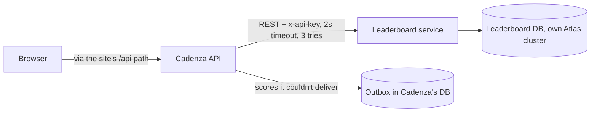

# Microservice

The microservice this group added, either as a new feature or in place of part
of the existing application. Diagrams here are Mermaid, like those in
[architecture.md](architecture.md). When the service changes the architecture,
update the *Layers* diagram there too, and record the choices under
*Decisions*.

## Design

We added a **leaderboard service** as a new feature. It saves the score from
every finished game and ranks players on each song. Before this, scores only
existed in the browser and were lost when the results screen closed.

It works well as a separate service because scores are their own kind of data.
The rest of the app doesn't need them, and the leaderboard only needs a user's
ID and name, not their password or the song's notes. If it goes down, people
can still play.

The code is in [`leaderboard/`](../leaderboard). It is a small Express app with
one Mongoose model (`Score`). It has its **own MongoDB Atlas cluster**,
separate from the main app's database, and is deployed as its **own Vercel
project**.



## API

Base URL: <https://leaderboard-pi-five.vercel.app>

```
LEADERBOARD=https://leaderboard-pi-five.vercel.app
```

Errors always come back as `{ "error": { "code": "...", "message": "..." } }`.

| Method and path | What it does |
| --- | --- |
| `GET /health` | `200` if the service and its database are up, `503` if not |
| `GET /songs/:songId/leaderboard?limit=10` | Top players on a song (each player once, their best score). `limit` is 1–50. |
| `GET /users/:userId/scores` | A player's best score on each song |
| `POST /scores` | Saves a score. Needs the `x-api-key` header. |

```
curl $LEADERBOARD/health

curl "$LEADERBOARD/songs/mary-had-a-little-lamb/leaderboard?limit=5"

USER_ID=$(curl -s "$LEADERBOARD/songs/mary-had-a-little-lamb/leaderboard?limit=1" | grep -o '"userId":"[^"]*"' | cut -d'"' -f4)
curl "$LEADERBOARD/users/$USER_ID/scores"

curl -X POST $LEADERBOARD/scores \
  -H "Content-Type: application/json" \
  -H "x-api-key: <key>" \
  -d '{"scoreId":"demo-1","userId":"demo-user","username":"demo","songId":"curl-demo","score":2400,"accuracy":92.5,"maxCombo":18,"speed":1}'
```

The API key is included with our submission instead of in the repo. Without
it, `POST /scores` returns `401`. The example posts to a fake song,
`curl-demo`, so it doesn't change the real leaderboard. Running it twice
returns `"duplicate": true` instead of saving it again.

## Characteristics

- **Self-contained:** it has its own database and doesn't call back into the
  main app.
- **Lightweight:** one job (saving and ranking scores), four endpoints, three
  dependencies.
- **Implementation-independent:** the main app only uses its REST API and
  shares no code with it.
- **Independently deployable:** its own folder, Vercel project and environment
  variables. Deploying it doesn't redeploy anything else.
- **Business-oriented:** it does one thing a player understands: "how do I
  rank on this song?"

## Data Consistency

Scores refer to users and songs in the main database, so we needed a way to
keep the two in sync without sharing a database:

- Each score stores a copy of the username, so the service never has to look
  users up.
- If the service can't be reached, the main app saves the score in a
  `PendingScore` collection in its own database (an outbox). After its next
  successful call to the service, it re-sends those scores, so the leaderboard
  catches up eventually.
- Every score has a unique `scoreId`, and the service ignores IDs it already
  has, so retries and re-sends never create duplicates.

## How It Is Called

The main app calls the service synchronously over REST from
[`server/services/leaderboardClient.js`](../server/services/leaderboardClient.js).
The browser never calls it directly. Only the main app knows who is logged in
and holds the API key.

- When a song ends, the results screen sends the score to the main app's
  `POST /scores`, which forwards it to the service.
- Song select gets the top five from the main app's
  `GET /songs/:songId/leaderboard`, which reads it from the service.

We used a **timeout with retries**. Each attempt times out after 2 seconds,
with up to 3 attempts. If all of them fail, the score goes to the outbox and
the game keeps working. We tested this by stopping the service and by making
it hang. Both times the score was queued and delivered once the service came
back.

You can see the app calling the service through the live site:

```
curl "https://se-project-group-3.vercel.app/api/songs/mary-had-a-little-lamb/leaderboard?limit=3"
```
