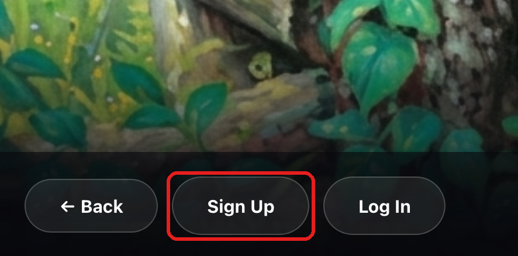
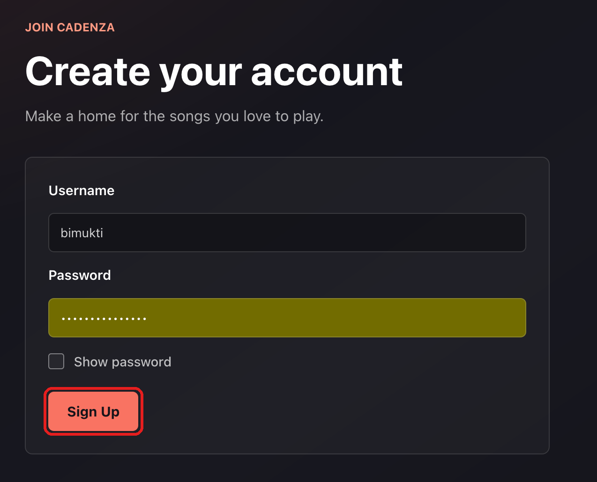
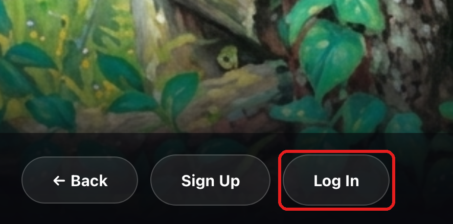
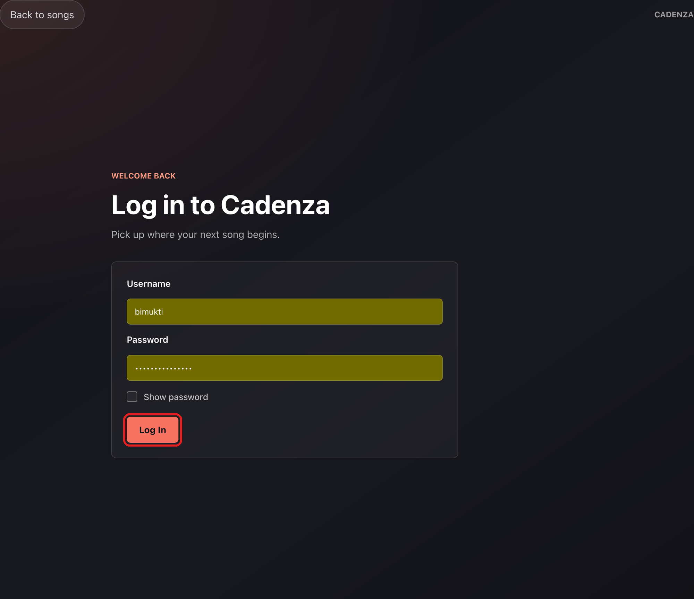
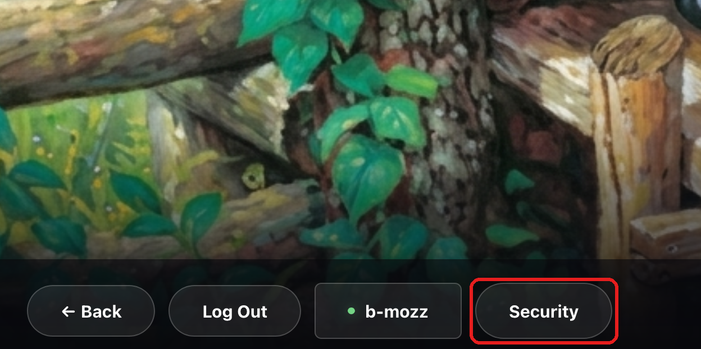
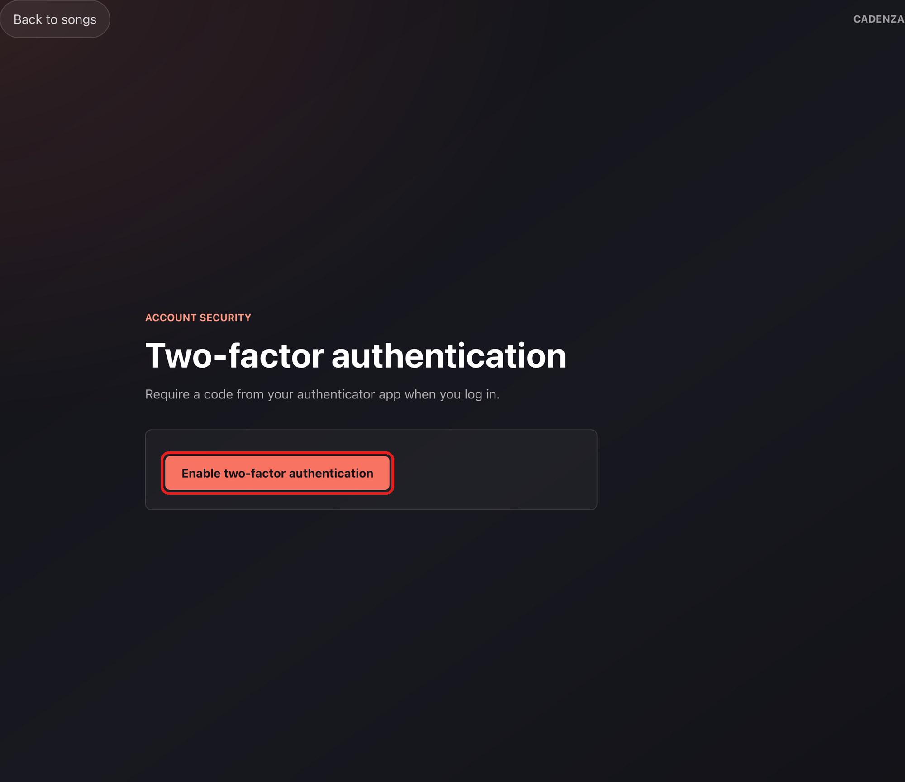
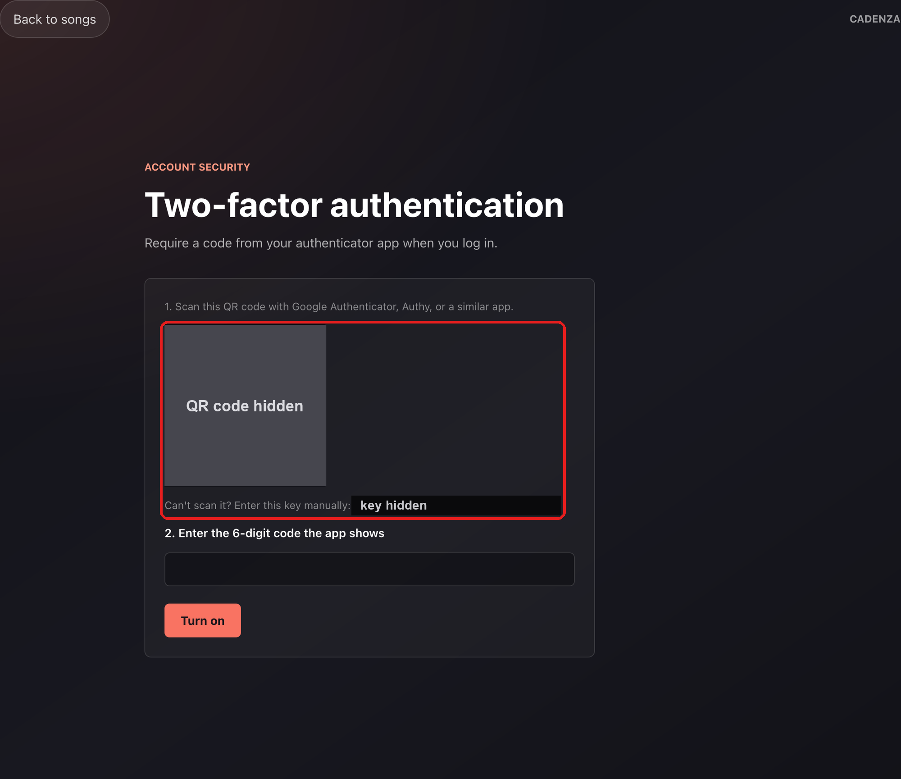
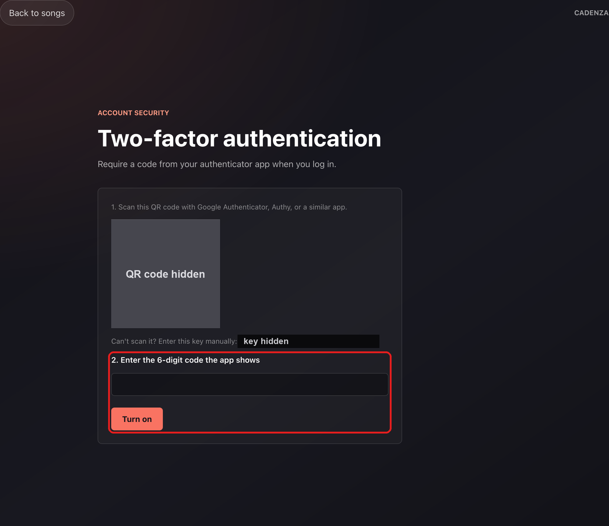
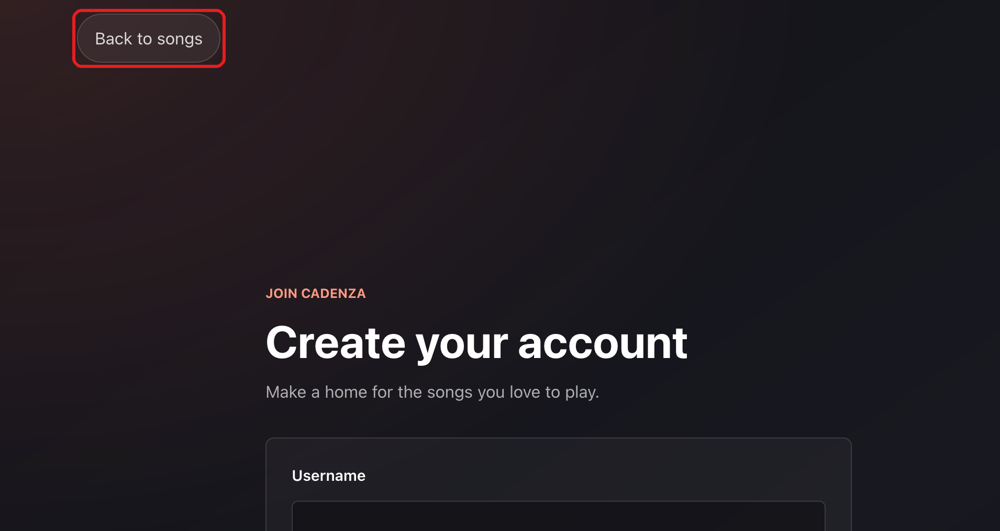
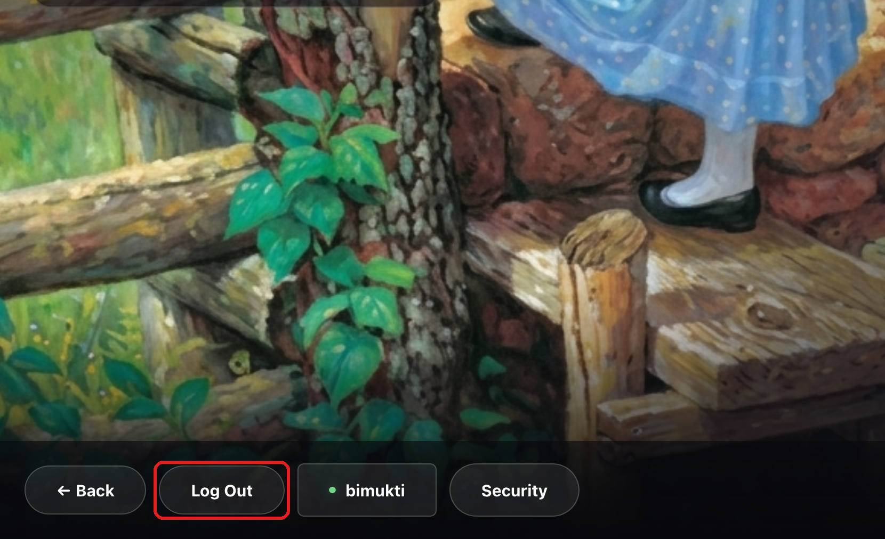

# Security and Privacy

Cadenza adds **two-factor authentication (2FA)** using time-based one-time
passwords (TOTP), the 6-digit codes shown by apps like Google Authenticator or
Authy. Before this, signing in only required a username and password.

## Feature

2FA is opt-in. A signed-in user can turn it on from the **Security** page
(`/settings/security`, linked from the song select screen):

1. They click **Enable two-factor authentication** and the page shows a QR
   code, plus the key as text for people who can't scan.
2. They scan it with an authenticator app, which starts showing a new 6-digit
   code every 30 seconds.
3. They type the current code to confirm the app is set up. Only then is 2FA
   switched on for their account.

From then on, signing in takes two steps: the password, then the current code
from the app. A correct password alone no longer logs anyone in.

## Implementation

All permalinks point to commit
[`a11e452`](https://github.com/CSCI-40500-77100-Fall-2026/se-project-group-3/tree/a11e4525c6a15bc4e5b5754e1a2685601f9d73d8).

**Libraries:** [`otplib`](https://www.npmjs.com/package/otplib) generates
secrets and checks codes, [`qrcode`](https://www.npmjs.com/package/qrcode)
renders the setup QR code, and
[`express-rate-limit`](https://www.npmjs.com/package/express-rate-limit) limits
code guessing. Encryption uses Node's built-in `crypto` module.

### Storing the secret

- The `User` model has three new fields: the TOTP secret, whether 2FA is on,
  and the last time step a code was accepted. The secret and last time step
  are removed from every JSON response, like the password hash:
  [`server/models/User.js#L6-L17`](https://github.com/CSCI-40500-77100-Fall-2026/se-project-group-3/blob/a11e4525c6a15bc4e5b5754e1a2685601f9d73d8/server/models/User.js#L6-L17)
- The secret is encrypted with AES-256-GCM before it is saved, using a key
  from the `TOTP_ENCRYPTION_KEY` environment variable. Each secret gets a
  random IV, and GCM's authentication tag makes tampered ciphertext fail to
  decrypt:
  [`encrypt`](https://github.com/CSCI-40500-77100-Fall-2026/se-project-group-3/blob/a11e4525c6a15bc4e5b5754e1a2685601f9d73d8/server/utils/encryption.js#L11-L25),
  [`decrypt`](https://github.com/CSCI-40500-77100-Fall-2026/se-project-group-3/blob/a11e4525c6a15bc4e5b5754e1a2685601f9d73d8/server/utils/encryption.js#L28-L46)

### Turning 2FA on

- `POST /users/totp/setup` creates a secret, saves it encrypted, and returns
  the QR code and the key. It refuses if 2FA is already on:
  [`setUpTOTP`](https://github.com/CSCI-40500-77100-Fall-2026/se-project-group-3/blob/a11e4525c6a15bc4e5b5754e1a2685601f9d73d8/server/controllers/totpController.js#L20-L52)
- `POST /users/totp/verify-setup` checks the first code and only then sets
  `totpEnabled`, so a half-finished setup can't lock anyone out:
  [`verifyTOTPSetUp`](https://github.com/CSCI-40500-77100-Fall-2026/se-project-group-3/blob/a11e4525c6a15bc4e5b5754e1a2685601f9d73d8/server/controllers/totpController.js#L107-L137)
- Both routes require a normal signed-in session:
  [`server/routes/users/index.js#L16-L17`](https://github.com/CSCI-40500-77100-Fall-2026/se-project-group-3/blob/a11e4525c6a15bc4e5b5754e1a2685601f9d73d8/server/routes/users/index.js#L16-L17)
- Frontend: the Security page
  ([`TwoFactorSetup.jsx`](https://github.com/CSCI-40500-77100-Fall-2026/se-project-group-3/blob/a11e4525c6a15bc4e5b5754e1a2685601f9d73d8/client/src/components/TwoFactorSetup.jsx#L33-L83))
  and its route
  ([`App.jsx#L26`](https://github.com/CSCI-40500-77100-Fall-2026/se-project-group-3/blob/a11e4525c6a15bc4e5b5754e1a2685601f9d73d8/client/src/App.jsx#L26)).

### Checking a code

One helper, `checkTOTP`, is shared by setup and sign-in. It decrypts the
secret, checks the code with otplib, and **rejects any code from a time step
that was already used**, so the same code can't be used twice. It then records
the time step it accepted:
[`checkTOTP`](https://github.com/CSCI-40500-77100-Fall-2026/se-project-group-3/blob/a11e4525c6a15bc4e5b5754e1a2685601f9d73d8/server/controllers/totpController.js#L59-L102)

### Signing in with 2FA

1. `POST /users/signin` checks the password. If 2FA is on, it does **not** log
   the user in. It sets a short-lived (5 minute) `pending2fa` cookie and
   replies `{ totpRequired: true }`:
   [`signInUser`](https://github.com/CSCI-40500-77100-Fall-2026/se-project-group-3/blob/a11e4525c6a15bc4e5b5754e1a2685601f9d73d8/server/controllers/usersController.js#L75-L80),
   [`setPendingCookie`](https://github.com/CSCI-40500-77100-Fall-2026/se-project-group-3/blob/a11e4525c6a15bc4e5b5754e1a2685601f9d73d8/server/utils/authCookie.js#L48-L56)
2. `POST /users/totp/verify-signin` only accepts requests with a valid pending
   cookie:
   [`requirePendingTwoFactor`](https://github.com/CSCI-40500-77100-Fall-2026/se-project-group-3/blob/a11e4525c6a15bc4e5b5754e1a2685601f9d73d8/server/middleware/pendingTwoFactor.js#L7-L28)
3. If the code is right, it swaps the pending cookie for the normal 24-hour
   login cookie:
   [`verifyTOTPSignIn`](https://github.com/CSCI-40500-77100-Fall-2026/se-project-group-3/blob/a11e4525c6a15bc4e5b5754e1a2685601f9d73d8/server/controllers/totpController.js#L145-L175)

The pending token carries a `purpose: "2fa"` claim, and the normal auth
middleware rejects any token with that claim. So the pending token can't be
used as a login, even if someone copies it into the login cookie by hand:
[`server/middleware/auth.js#L14-L18`](https://github.com/CSCI-40500-77100-Fall-2026/se-project-group-3/blob/a11e4525c6a15bc4e5b5754e1a2685601f9d73d8/server/middleware/auth.js#L14-L18)

Frontend: when the server replies `totpRequired`, the login page switches to a
code form instead of logging in:
[`LogIn.jsx#L41-L44`](https://github.com/CSCI-40500-77100-Fall-2026/se-project-group-3/blob/a11e4525c6a15bc4e5b5754e1a2685601f9d73d8/client/src/components/LogIn.jsx#L41-L44),
[`handleCodeSubmit`](https://github.com/CSCI-40500-77100-Fall-2026/se-project-group-3/blob/a11e4525c6a15bc4e5b5754e1a2685601f9d73d8/client/src/components/LogIn.jsx#L61-L84),
[code form](https://github.com/CSCI-40500-77100-Fall-2026/se-project-group-3/blob/a11e4525c6a15bc4e5b5754e1a2685601f9d73d8/client/src/components/LogIn.jsx#L153-L192)

### Limiting guesses

Code checks are limited to 5 wrong codes per user per 5 minutes. The count is
kept per user, not per IP address, so signing in again or switching networks
doesn't reset it. Correct codes don't count against the limit:
[`server/middleware/rateLimit.js#L15-L25`](https://github.com/CSCI-40500-77100-Fall-2026/se-project-group-3/blob/a11e4525c6a15bc4e5b5754e1a2685601f9d73d8/server/middleware/rateLimit.js#L15-L25),
applied in
[`server/routes/users/index.js#L21`](https://github.com/CSCI-40500-77100-Fall-2026/se-project-group-3/blob/a11e4525c6a15bc4e5b5754e1a2685601f9d73d8/server/routes/users/index.js#L21)

## Threat Addressed

**Stolen or guessed passwords.** Chapter 7 describes how attackers get
into accounts by guessing passwords or stealing them, for example through
phishing, reused passwords, or leaked password lists. Before this feature, a
correct password was all an attacker needed. 2FA adds a second factor based on
*something the user has*, their phone with the authenticator app, so a stolen
password alone no longer gives access.

The rest of the implementation closes the gaps an attacker would try next:

- **Brute-force guessing of the code.** There are only 1,000,000 possible
  6-digit codes. Without a limit, someone with the password could try them all
  within a few hours. With 5 wrong attempts per 5 minutes, guessing would take
  years.
- **Replaying a code.** A code seen over someone's shoulder or captured by an
  attacker can't be used again, because each time step is accepted only once.
- **Exposure of stored data.** If the database leaks, the TOTP secrets are
  encrypted, so the attacker can't use them to generate codes. Secrets are
  also never included in API responses after setup.
- **Skipping the second step.** The "password OK, code pending" token is
  short-lived and can't be used as a normal login.

## How to Try It

You need an authenticator app on your phone: Google Authenticator, Microsoft
Authenticator, or Authy all work. If you can't scan a QR code, any app that
accepts a typed-in key works too.

1. Open <https://se-project-group-3.vercel.app/>, click **Sign Up**, and
   create an account. 2FA is off for new accounts.

   

   

2. Click **Log In** and log in. Note that no code is asked for yet.

   

   

3. On the song select screen, click **Security** (bottom left, next to your
   username).

   
4. Click **Enable two-factor authentication**. A QR code appears.

   

5. Scan it with your authenticator app, or type the key shown under it into
   the app. A "Cadenza" entry appears in the app. (The QR code and key are
   hidden in this screenshot because they are the account's secret. You'll see
   your own.)

   

6. Type the 6-digit code from the app and click **Turn on**. The page now says
   2FA is on. (Typing a wrong code here first shows "Invalid Code.")

   

7. Click **Back to songs** (top left), then **Log Out**.

   

   

8. Log in again with your username and password. Instead of logging you in,
   the page now asks for a code.
9. Enter the current code from the app. You're logged in. Refreshing the page
   keeps you logged in.

Other things to try:

- **Wrong code:** enter `000000` at step 9. You get "Invalid code."
- **Guessing limit:** enter a wrong code 6 times in a row. The 6th try shows
  "Too many attempts. Please wait a few minutes and try again," and even the
  correct code is refused until the 5 minutes are up.
- **No reuse:** after logging in with a code, log out and log in again within
  the same 30 seconds using the same code. It's refused. Wait for the next
  code. (For the same reason, right after step 6, wait for a new code before
  logging in.)
- **Secret not exposed:** open the browser's developer tools, then the
  Network tab, and reload the page. The response from `/api/users/me` shows
  `totpEnabled: true`, but no secret.

## Limitations

- **No recovery codes and no way to turn 2FA off.** A user who loses their
  phone is locked out of their account. Real systems give one-time backup
  codes at setup and let users disable 2FA after re-entering their password.
- **The password step isn't rate limited.** Passwords can still be guessed
  without limit. 2FA stops those attackers from getting in, but they can find
  out the password, which matters if the user reuses it elsewhere.
- **The guessing limit is per server instance.** The attempt count is kept in
  memory. On Vercel, each serverless instance has its own count, and it resets
  when an instance restarts, so the real limit is looser than 5 per 5 minutes.
  A shared store such as Redis would make it exact.
- **Real-time phishing.** A fake login page that asks for the password and the
  current code and passes both to the real site right away still works,
  because the code is valid for about 30 seconds. Phishing-resistant methods
  like passkeys (WebAuthn) are needed to stop that.
- **Stolen login cookies.** 2FA only protects the moment of signing in. If
  someone steals the 24-hour login cookie afterwards (for example, through an
  XSS bug or malware on the user's computer), they're logged in without a
  code. The cookie is `httpOnly`, which blocks it from JavaScript, but there
  is no session timeout or re-authentication for sensitive actions.
- **The encryption key protects the secrets only if it stays secret.** An
  attacker who gets both the database and the `TOTP_ENCRYPTION_KEY`
  environment variable can decrypt every secret. Changing the key also
  requires re-encrypting existing secrets, which isn't built.
- **A compromised phone.** Anyone who has the user's unlocked phone, or
  malware on it, can read the codes.
